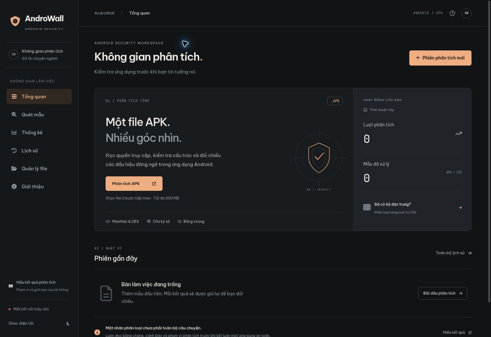

# AndroWall web workspace

The existing Flask/Jinja web application now uses a graphite palette with a copper accent, shared workspace navigation, and a responsive mobile menu. Dark is the initial theme for new sessions. Existing saved theme preferences and browser scan history use their original storage keys.

## Changes

- Rebuilt the overview as a focused inspection workspace: one primary APK entry, an integrated activity rail, a CSV shortcut, and a full-width recent-session journal. Removed the marketing banner, tilted APK artwork, detached metric cards, and classification strip. No demonstration scan records are injected.
- Redesigned the scan input and waiting state with the same graphite/copper controls; existing upload endpoints, result rendering, evidence sections, and MobSF polling remain in place.
- Applied the shared typography, tables, controls, surfaces, and light/dark themes to statistics, history, file management, and information pages.
- Added mobile navigation, Escape-to-close, a skip link, and keyboard controls for APK/CSV tabs.
- Removed unsupported fixed accuracy/dataset claims from presentation pages. About explains the distinction between model confidence and evaluated system accuracy.
- Dashboard non-Benign percentage now uses per-class statistics, excludes unclassified samples, and displays `—` when no classified samples exist. It no longer treats an entire CSV batch as the first sample's class.
- New overview labels and filenames are rendered as text nodes, including content from browser storage.



The screenshot uses rendered templates with no scanner server. Its disconnected server indicator is expected for this UI-only preview.

## Run with the existing environment (Windows PowerShell)

From the project root, after checking out this branch:

```powershell
.\venv\Scripts\python.exe web\app.py
```

Open the local address printed by Flask. No new frontend dependencies or build step are needed. Existing CDN dependencies are retained, so the UI still needs those resources available.

## Verification performed

- Rendered all six active Flask/Jinja pages with a minimal Flask context; file-manager context included empty file lists.
- Node syntax checks passed for 17 rendered inline scripts and the new overview script.
- Overview checks covered empty/corrupt/inaccessible storage, populated history, totals, invalid dates, and HTML-bearing filenames/labels.
- Browser checks covered desktop overview/scanner, light/dark switching, APK/CSV switching (including the CSV query shortcut and arrow-key switching), empty dashboard/history, and file-manager tabs.
- Mobile layout was inspected in a 390px iframe (380px content viewport after scrollbar): no horizontal document overflow; menu open/close and Escape worked.
- `git diff --check` passed.

Real APK scans, model inference, MobSF integration, live upload/delete, and PDF export have not been exercised in this environment. Run those checks against the project's configured Windows/Kali setup before merging for a demonstration. No scanner, model, or backend configuration files are modified.

## Design references

Visual references were reviewed at ThemeForest, Dribbble security dashboards, Awwwards, and Uiverse buttons. The workspace markup, illustration, and button styles are project-specific; no paid template or third-party button source was copied.
